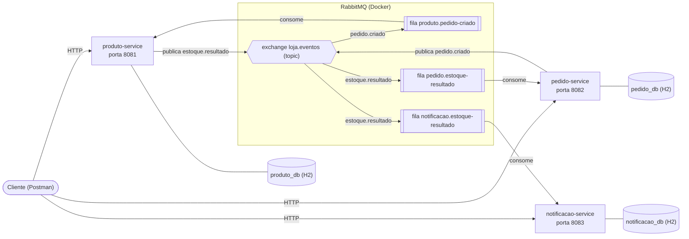
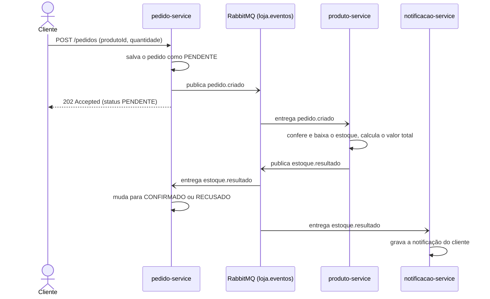

# Documentação da aplicação: Loja de Games em Microsserviços

Projeto final da disciplina de **APIs e Microsserviços** (TADS, IFMS), Prof. Fernando Cesar Balbino.

**Integrantes:** Guilherme Alves, João Pedro Borges, Matheus Costa

---

## 1. Domínio escolhido

**Comércio eletrônico de jogos (loja de games).**

Escolhemos uma loja virtual de jogos eletrônicos porque é um domínio que todo o grupo conhece como consumidor e que tem regras de negócio claras e fáceis de verificar:

- os jogos são vendidos para **plataformas diferentes** (PC, PlayStation 5, Xbox Series e Nintendo Switch);
- o **estoque é limitado**, principalmente em lançamentos, então um pedido pode ser aceito ou recusado;
- o cliente precisa ser **avisado** do resultado da compra.

Essas três necessidades se separam naturalmente em responsabilidades diferentes (catálogo e estoque, pedidos e avisos ao cliente), o que torna o domínio adequado para uma arquitetura de microsserviços.

## 2. Propósito da aplicação

A aplicação resolve o processo de **venda de um jogo**, do cadastro no catálogo até o aviso final ao cliente:

1. a loja mantém o **catálogo** de jogos, com preço, plataforma e quantidade em estoque;
2. o cliente faz um **pedido** informando o jogo e a quantidade;
3. o sistema **verifica e reserva o estoque**, calcula o **valor total** e decide se o pedido é **confirmado** ou **recusado**;
4. o cliente recebe uma **notificação** com o resultado e pode marcá-la como lida.

Como a verificação do estoque e o envio do aviso acontecem em serviços separados, o pedido é **aceito na hora** e processado em segundo plano. O cliente não fica esperando todos os serviços terminarem, e um serviço fora do ar não derruba os outros.

## 3. Arquitetura

A solução tem **3 microsserviços** em Java com Spring Boot, cada um com o **próprio banco de dados H2** (padrão *database per service*). Eles se comunicam de forma **assíncrona** por meio do **RabbitMQ**, que roda em um container Docker.

**Legenda:** as setas com "HTTP" são comunicação **síncrona** entre o cliente e cada serviço. As setas que passam pelo RabbitMQ são comunicação **assíncrona** entre os serviços. Nenhum serviço acessa o banco de outro.

### Mensageria

| Item | Nome |
|---|---|
| Exchange (tipo *topic*) | `loja.eventos` |
| Routing key do pedido criado | `pedido.criado` |
| Routing key do resultado do estoque | `estoque.resultado` |
| Fila do produto-service | `produto.pedido-criado` (recebe `pedido.criado`) |
| Fila do pedido-service | `pedido.estoque-resultado` (recebe `estoque.resultado`) |
| Fila do notificacao-service | `notificacao.estoque-resultado` (recebe `estoque.resultado`) |

As mensagens trafegam em **JSON**. Cada serviço declara, ao iniciar, a exchange, a sua própria fila e o *binding* (a regra que liga a fila à exchange pela routing key).

### Tecnologias

Java 25, Spring Boot 4.1.2 (Spring Web MVC, Spring Data JPA, Validation, Spring AMQP), banco H2 em arquivo, Lombok, RabbitMQ 4 (Docker), Maven Wrapper.

### Organização interna de cada serviço

Os três serviços seguem a mesma divisão em camadas:

| Pasta | Responsabilidade |
|---|---|
| `controller` | recebe as requisições HTTP |
| `messaging` | listeners que consomem as filas do RabbitMQ e os eventos (mensagens) |
| `service` | regras de negócio, usadas tanto pelo controller quanto pelo listener |
| `repository` | acesso ao banco com Spring Data JPA |
| `entity` | classes que viram tabelas no banco |
| `dto` | formato dos dados recebidos pela API |
| `config` | configuração do RabbitMQ (exchange, fila, binding, conversor JSON) |
| `exception` | tratamento de erros com respostas JSON padronizadas |

## 4. Descrição dos microsserviços

### produto-service (porta 8081): catálogo e estoque

**Responsabilidade:** é o dono dos dados dos jogos. Mantém o catálogo e controla o estoque.

**Funcionalidades:**
- cadastrar, consultar, editar e excluir jogos (CRUD completo);
- filtrar o catálogo por plataforma;
- carga inicial com 8 jogos quando o banco está vazio;
- ao receber um pedido pelo RabbitMQ, verifica se o jogo existe e se há estoque suficiente, **baixa o estoque**, calcula o **valor total** (preço × quantidade) e publica o resultado.

| Método | Rota | Descrição |
|---|---|---|
| POST | `/produtos` | cadastra um jogo (201) |
| GET | `/produtos` | lista os jogos (filtro opcional `?plataforma=PC`) |
| GET | `/produtos/{id}` | busca um jogo (404 se não existir) |
| PUT | `/produtos/{id}` | edita um jogo |
| DELETE | `/produtos/{id}` | exclui um jogo (204) |

**RabbitMQ:** consome `pedido.criado` e publica `estoque.resultado`.

### pedido-service (porta 8082): pedidos

**Responsabilidade:** é o dono dos pedidos e do status de cada um.

**Funcionalidades:**
- criar um pedido (`produtoId` e `quantidade`), que começa como **PENDENTE**;
- consultar pedidos, com status (**PENDENTE**, **CONFIRMADO** ou **RECUSADO**), valor total e motivo da recusa;
- ao receber o resultado do estoque, atualiza o pedido para **CONFIRMADO** (com o valor total) ou **RECUSADO** (com o motivo).

| Método | Rota | Descrição |
|---|---|---|
| POST | `/pedidos` | cria um pedido e inicia o fluxo assíncrono (202 Accepted) |
| GET | `/pedidos` | lista os pedidos |
| GET | `/pedidos/{id}` | busca um pedido (404 se não existir) |

**RabbitMQ:** publica `pedido.criado` e consome `estoque.resultado`.

### notificacao-service (porta 8083): avisos ao cliente

**Responsabilidade:** é o dono das notificações enviadas ao cliente.

**Funcionalidades:**
- ao receber o resultado do estoque, grava um aviso, por exemplo: "Pedido #1 confirmado! Total: R$ 499,80. Obrigado pela compra." ou "Pedido #2 recusado: Estoque insuficiente (disponível: 1)";
- consultar notificações, com filtro por pedido ou por lidas/não lidas;
- marcar uma notificação como lida.

| Método | Rota | Descrição |
|---|---|---|
| GET | `/notificacoes` | lista as notificações (filtros opcionais `?pedidoId=1` e `?lida=false`) |
| PATCH | `/notificacoes/{id}/lida` | marca uma notificação como lida (404 se não existir) |

**RabbitMQ:** consome `estoque.resultado`. Não publica mensagens.

## 5. Fluxo de dados

### Comunicações síncronas (HTTP)

Toda interação do **cliente** com o sistema é feita por **HTTP**, direto no serviço responsável: cadastrar e consultar jogos no produto-service, criar e consultar pedidos no pedido-service e consultar e marcar notificações no notificacao-service. O cliente recebe a resposta na hora.

**Não há chamadas HTTP entre os serviços.** Toda a comunicação entre eles é assíncrona.

### Comunicações assíncronas (RabbitMQ): fluxo principal da compra

1. O cliente faz `POST /pedidos` no **pedido-service**. O pedido é salvo como **PENDENTE** e a API responde **202 Accepted** imediatamente.
2. O pedido-service publica o evento **`pedido.criado`** (`pedidoId`, `produtoId`, `quantidade`) na exchange `loja.eventos`.
3. A exchange entrega o evento na fila do **produto-service**, que:
   - se o jogo existe e há estoque, **baixa a quantidade** e calcula o valor total;
   - se o jogo não existe ou o estoque é insuficiente, recusa e informa o motivo.
4. O produto-service publica o evento **`estoque.resultado`** (`pedidoId`, `sucesso`, `motivo`, `valorTotal`). Ele não sabe quem vai receber: a exchange entrega uma **cópia** em cada fila que tem binding para essa routing key.
5. O **pedido-service** atualiza o status para **CONFIRMADO** (guardando o valor total) ou **RECUSADO** (guardando o motivo).
6. O **notificacao-service** grava a notificação para o cliente.

**Efeitos verificáveis:** depois do fluxo, é possível conferir o status do pedido em `GET /pedidos/{id}`, o estoque reduzido em `GET /produtos/{id}` e o aviso em `GET /notificacoes`.

### Tratamento de falhas

| Situação | Comportamento |
|---|---|
| Jogo inexistente ou estoque insuficiente | o pedido fica **RECUSADO** com o motivo, e o estoque não é alterado |
| RabbitMQ fora do ar ao criar o pedido | o pedido fica **RECUSADO** e a API responde **503 Service Unavailable** |
| Erro ao processar uma mensagem | o listener tenta **3 vezes** (1 s entre as tentativas) e depois descarta a mensagem, evitando um loop infinito de reentrega |
| Resultado repetido para o mesmo pedido | é ignorado: só um pedido **PENDENTE** muda de status (idempotência) |
| Serviço consumidor desligado | as mensagens ficam guardadas na fila (filas duráveis) e são processadas quando ele voltar |
| Dados inválidos ou registro inexistente na API | resposta **400** ou **404** em JSON, com a mensagem do erro |

---

As instruções de instalação, configuração e execução estão no [README](../README.md).
